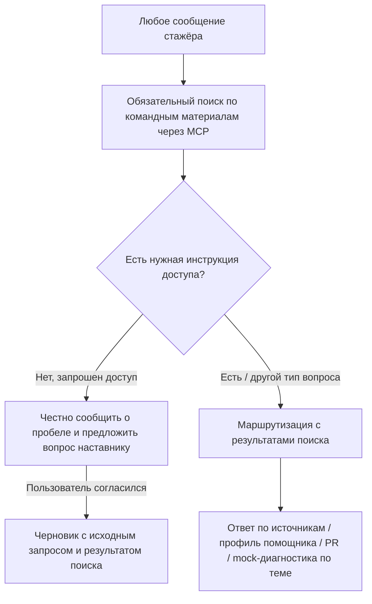

# Первая линия помощи: документы, доступы, адресаты, эскалация

`skills/team-help/SKILL.md` описывает общий workflow, `skill.json` — его версию и контракт `team-help.v1`. Это один локальный сценарий приложения; отдельные агенты/сервисы для HR, отпусков и БД не создаются. PR Self-Review и CI продолжают использовать прежний процесс.

## Что доступно в стандартном демо

| Запрос | Результат |
|---|---|
| «Что писать в описании задачи?» | Раздел процесса с критериями приёмки и ссылка на конкретный заголовок. |
| «Как получить доступ к Grafana?» | Роль Viewer, demo-владелец, необходимые сведения и ссылка на демонстрационную заявку. |
| «Как получить доступ к репозиторию?» | Уровень Developer, demo-владелец и отдельная ссылка на обращение. |
| «Как оформить больничный?» / «Вопрос по HR» | Профиль HR-помощника. |
| «Как оформить отпуск?» | Профиль помощника по отпускам. |
| «Кому задать вопрос по PostgreSQL / базам данных?» | Профиль помощника юнита БД. |
| «Нужен доступ к Kubernetes» | Поиск по документам, при отсутствии совпадений — уточнение; не подставляется инструкция Grafana или Git. |
| «Не могу запустить orders: 502. Уже пробовал перезапуск Docker» → «Подготовь вопрос наставнику» | Поиск инструкции и mock-диагностика; по просьбе — черновик с известной проблемой, проверками, источниками и PR/SHA. |

Все профили и процессы синтетические, не регламенты и API Авито. Локальная страница профиля показывает адресата и область помощи; сообщения ботам, кадровые действия и заявки на доступ не отправляются. Настоящие URL может задать владелец команды, когда они будут известны.

## Каталог вместо веток для каждого бота

В `teams/demo-backend/context.json`:

- `skills` включает `team-help`, `capabilities.team_help` указывает его ID.
- `help.topics` связывает демонстрационные формулировки с документом и заголовком.
- `help.access` содержит ресурс, aliases, раздел инструкции и ссылку на заявку. Права/владелец/шаги описаны в Markdown; модель не генерирует их самостоятельно.
- `help.assistants` содержит ID, имя, описание, темы, профиль и необязательный URL.

Чтобы подключить ещё одного помощника:

1. Добавьте раздел в `assistant-directory.md`, например `## Релизы`, с честным описанием демонстрационного адресата.
2. Добавьте в `help.assistants`:

```json
{
  "id": "releases",
  "name": "Помощник по релизам",
  "description": "Кому адресовать вопросы о порядке релиза.",
  "keywords": ["релиз", "выкат"],
  "document_id": "assistant-directory",
  "section": "Релизы"
}
```

3. Спросите о релизе. Конфигурация перечитывается при новой операции; Go-обработчик менять не нужно. `url` можно добавить позже; без него ссылка ведёт на локальный профиль.

Загрузчик проверяет IDs, дубли, существование непустого раздела, корректность URL и неоднозначные aliases ресурсов. Неизвестные target ID и источники не допускаются. Каталог применяется только для настроенной demo-команды, это не поиск по всей компании.

## Demo и Live

Demo выбирает известные темы по ключевым словам, ресурсы — по aliases с границами слов, затем извлекает фактический Markdown. Для нескольких совпадений темы выбирается самое длинное; при равенстве — первая запись каталога. Это не свободное понимание намерения и не исполнение Markdown как кода.

Live получает фактический `SKILL.md`, каталог, документы, историю и текущий PR-отчёт. Модель выбирает:

- `answer_question` с `document_ids` формата `document-id#Точный заголовок` для ответа по источнику;
- `find_team_help(kind="access", target_id=...)` для конкретного ресурса;
- `find_team_help(kind="handoff", target_id=...)` для любого настроенного адресата;
- `search_team_knowledge(query=...)` для поиска по локальным материалам и доступной mock-диагностики;
- `find_team_help(kind="escalation", target_id="")` для подготовки обращения по просьбе пользователя. В Live намерение интерпретирует модель; backend не отменяет выбор черновика из-за порядка слов в запросе. Черновик не отправляет сообщений.

Сервер строит ссылки и исполняет lookup только по доверенной конфигурации. Выдуманные ID/разделы не становятся ссылками. Переданный моделью свободный `mentor_draft` в этом workflow заменяется сборкой из реального контекста. Для неизвестной рабочей проблемы сначала используется поиск; при нехватке сведений — уточнение. Правила и адресаты не придумываются.

Маршрутизация не вызывает неизвестные корпоративные API и не запускает отдельную нейросеть каждого бота. В будущем профиль может вести на настоящий инструмент при наличии подтверждённых адресов/контрактов.

## Эскалация и сохранение

Без описания проблемы Buddy сначала спрашивает, что пользователь пытался сделать, какую ошибку получил и что проверил. Черновик содержит известный вопрос, подходящие сообщения стажёра, результаты последнего подходящего поиска и диагностики с временем проверки, а также текущий PR/CI. Отсутствие результатов поиска тоже сохраняется. Текст ассистента не выдаётся за выполненные пользователем проверки. Неизвестные сведения помечены как неуказанные; пустые `[задача]`/`[ошибка]` не используются.

Черновик можно отредактировать и скопировать; автоматически он не отправляется. Сервер сохраняет сгенерированный вариант, правки в textarea остаются локально в текущей вкладке. История ответов, источников и handoff сохраняется. `help_execution` содержит тип результата, target ID, ID/версию skill и хеш инструкций. Для поиска поле `investigation` сохраняет запрос, до пяти источников/выдержек, время и фактические наблюдения инструментов. В Live дополнительно сохраняется модель и выбранная функция.

Ссылки на обычные разделы получают якоря `section-N`, существующие идентификаторы правил ревью сохраняются. После изменения структуры документа порядковые якоря могут измениться; ссылка всегда открывает текущую версию командного файла.

## Совместимость и проверки

Без каталога/подключённого skill остаются прежние ответы. `people_agent_url` поддерживается только старым fallback без активного `team-help`; новый каталог позволяет настраивать любое число направлений.

Тесты проверяют фактическое чтение Markdown, источники/якоря, точный ресурс доступа, отсутствие подмены GitLab ресурсом Git, разные handoff, добавление нового помощника во время работы, неизвестные цели, заполненную эскалацию, редактирование/копирование и восстановление истории. Live проверяется локальным тестовым API, не платной моделью; реальный smoke test требует отдельно выбранных провайдера и ключа.

## Обязательный поиск перед каждым сообщением



Пример для демонстрации:

1. «Не могу запустить orders: получаю 502» — Buddy вызывает поиск, находит `troubleshooting#Orders: ответ 502`, читает Git MCP: PR/SHA, окружение STOPPED, CI FAILED. Показывает инструкцию `make training-up` и проверку `/healthz`. STOPPED — возможная причина, не доказанный диагноз.
2. «Не помогло» — поиск повторяется с предыдущим контекстом, статусы перечитываются. Buddy запрашивает URL, окружение, результат `/healthz` и логи без секретов. Он не считает выданную рекомендацию выполненной пользователем.
3. «Уже проверил /healthz: 503. Подготовь вопрос наставнику» — черновик объединяет сообщение стажёра и результаты инструментов, отдельно маркируя mock-наблюдения. Отправки сообщения нет.
4. «Как получить доступ к Kubernetes?» — поиск не находит инструкции, Buddy уточняет ресурс/окружение. «Подготовь вопрос наставнику» включает неуспешный поиск, без выдуманных прав или адреса заявки.

MCP-инструмент `search_team_knowledge` живёт в существующем backend на `/internal/knowledge`. Он использует общий внутренний secret и переданный сервером actor, в демо разрешён только `intern-1`. Передать путь к файлу, другой team ID или произвольный URL нельзя. Адаптер подключён через `service.KnowledgeTools`: настоящий сервис поиска впоследствии заменяет этот адаптер, без переписывания PR-флоу.

Поиск лексический, без морфологии/эмбеддингов: до пяти разделов с совпадениями, более высокий вес заголовка, выдержки до 1200 символов. Новый материал достаточно добавить в Markdown и `documents`. Пустой поиск и недоступный сервис различаются: сбой даёт повторяемую ошибку операции, а не сообщение «ничего не найдено». При ошибке окружения/CI выдаются доступные источники с явным указанием, что часть диагностики не выполнена. Смена SHA во время чтения отклоняет смешанный снимок.

Поиск/диагностика не запускают код, не перезапускают CI и не отправляют обращения. Показанная команда предназначена для самостоятельного выполнения. Для нового фактического статуса нужно повторить запрос: история хранит снимок, а не непрерывный мониторинг. В Live модель выбирает инструмент и цель поиска: information, access или troubleshooting. Backend собирает проверенные результаты поиска/диагностики, после чего один дополнительный LLM-вызов формулирует ответ по этим данным. Ссылки разрешены только на найденные источники. Информационный вопрос не запускает диагностику и не требует логов. Это ограниченный workflow, без универсального цикла агентов.

## Ревью реализации

Проверены сценарии, границы доверия и регрессии PR/CI. Политика Live предписывает поиск перед эскалацией на неизвестную проблему; явную просьбу о черновике модель интерпретирует без серверного списка точных фраз. Исправлены захват диагностики другой явно указанной проблемы, потеря контекста пустого поиска, лишние совпадения по общим словам и приоритет старого training-маршрута над поиском проблемы. Источники заново проверяются по документам команды: чужая ссылка или текст от адаптера не становятся фактом ответа. Тесты покрывают авторизацию MCP, обновление материалов, отсутствие результатов, временный сбой с повтором той же операции, недоступную диагностику, смену SHA, follow-up и сбор черновика без отправки.

Ограничения: Demo использует эвристики русского текста, поиск не понимает смысл и не гарантирует полноту. Каталог содержит одну демо-команду; настоящая многокомандная авторизация потребует адаптера ACL. Корпоративные боты представлены профилями, а не их работающими API. Реальный LLM-провайдер не проверен: Live-контракт проверяется локальным тестовым API. Реальные метрики снижения нагрузки наставника ещё нужно измерить на пользовательском прогоне.

### Поиск до маршрутизации

В настроенном приложении каждый `message` вызывает KnowledgeTools.Search до Demo-маршрутизации или Live Plan, включая приветствие и согласие на черновик. Результат передаётся модели в knowledge_evidence и сохраняется в help_execution.investigation. Повторное использование результата не изображает ещё один поиск. Если обязательный поиск недоступен, ответ не выдаётся как основанный на найденных материалах: операция завершается повторяемой ошибкой.

При пустом результате по неизвестному рабочему вопросу backend сам сообщает об этом и предлагает черновик; LLM не требуется для объявления пустого результата. Приветствия, известные действия с PR/окружением и уточнения по текущему отчёту обрабатываются по их контексту после обязательного поиска. «Да» после этого предложения собирает обращение с исходным вопросом. Это не отправка сообщения. Общие совпадения по CI/CD отфильтровываются, если конкретное название инструмента не встречается в источнике. Алиасы известных ресурсов берутся из каталога. В тестах проверяется поиск перед каждым из трёх сообщений: приветствие, неизвестный доступ, согласие на обращение.
